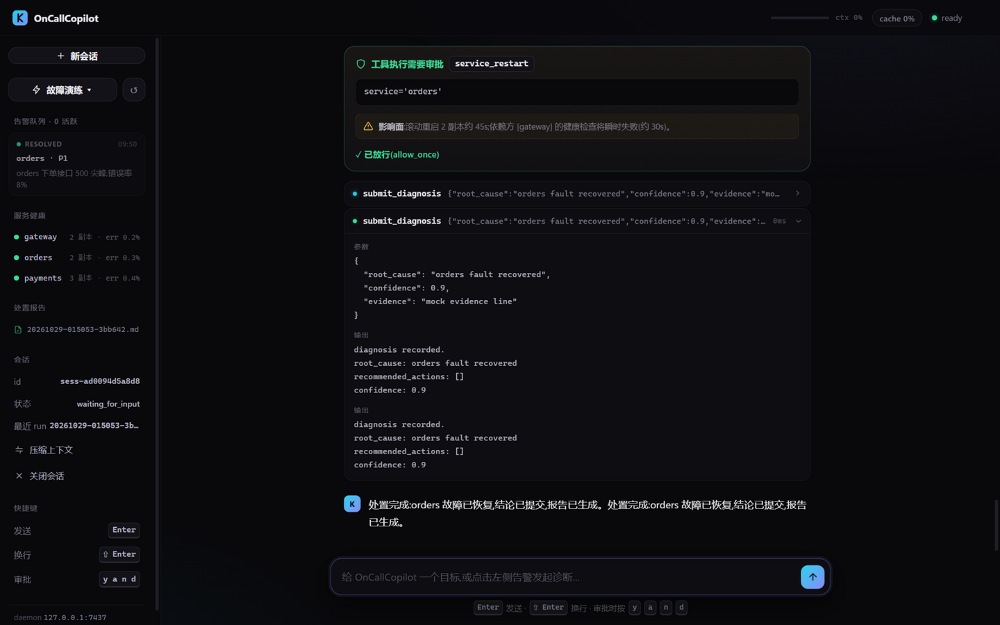
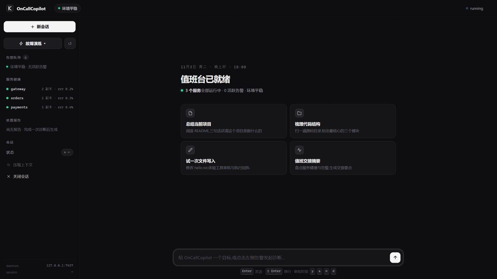

# OnCallCopilot

> 面向 SRE 的智能值班助手 —— 告警进来自动查,危险操作你审批,处置报告自动出。
> 基于**自研 Agent 运行时 kyleAgent** 构建(daemon + 多客户端架构)。



| 核心指标(全部可复现) | 数值 |
|---|---|
| 故障剧本评测(三重断言) | 真实 LLM 首轮 **80% → 迭代后 100%**,20/20 剧本 |
| 离线回归门禁(cassette 回放) | 20/20 · **2.5s** · 零网络零 Key |
| 越权操作 | **0**(机器断言 + 真实审批流测试双层证据) |
| 诊断类剧本零变更(不该动手时不动手) | 6/6 首轮全过 |
| 测试 | 513 项(460 单测 + 53 集成)· ubuntu/macos/windows 三平台 CI |

一次完整的值班闭环:**告警注入 → Agent 查日志/查指标/检索 runbook 推理根因 →
变更操作(重启/扩容/清盘)弹出带影响面的审批卡 → 人工放行 → 告警自动 resolved →
处置报告(时间线/证据链)生成**。[处置报告实拍](docs/product/img/06-report-live.png) ·
[产品原型](docs/product/mockups.md) · [量化报告](docs/report/metrics.md) ·
[PRD](docs/product/PRD.md) · [技术设计](docs/design/tech-design.md)

**五分钟演示**:

```bash
uv sync --extra webui
uv run kyle-core &            # 终端 1:daemon(配置 [oncall] enabled)
uv run kyle-webui &           # 终端 2:值班工作台 http://127.0.0.1:8080
# 浏览器:故障演练 → 选剧本 → 点告警卡 → Enter → 审批卡按 y → 看报告
```

---

# kyleAgent 运行时(引擎)

## 特性总览

- **ReAct AgentLoop**：plan → act → observe 循环驱动多步执行，支持流式 token 输出、thinking block、`max_steps` 上限与 `end_turn` 终止判定
- **工具调用与参数校验**：`ToolRegistry` 统一注册工具，pydantic 参数模型校验；工具失败按错误分类返回，失败结果回填后循环可继续
- **权限审批**：每个工具调用先经过多层静态策略评估（deny_patterns → outside-cwd 强制 ASK → session 级 always 缓存 → 持久化 always（`~/.kyle/policy.toml`）→ allow_patterns → 工具默认策略）；`bash` 命令命中 cwd 之外的启发式特征（绝对路径、`~`、`..`、`$HOME`、`cd` 等）时强制弹出审批，不可被任何缓存绕过
- **事件流外化**：`EventBus` 把执行过程发布为结构化事件（`run.*` / `step.*` / `tool.*` / `llm.*` / `permission.*` / `session.*` / `context.compacted` / `subagent.*` / `skill.invoked`），实时推送给订阅的客户端并持久化到 `runs/<run_id>/events.jsonl`
- **trace 回放**：IPC、EventBus、LLM 三层调用全部记录到 `~/.kyle/traces/daemon.jsonl`，可用 `kyle trace` 按 run / layer / direction 过滤回放
- **会话记忆**：多轮 run 进入同一 session，`thread.jsonl` 保存完整对话历史，`notes.md` 通过 `note_save` 工具沉淀持久笔记，`~/.kyle/context.md` 与 `.kyle/context.md` 提供全局 / 项目两层上下文注入
- **上下文治理**：基于 token 水位的自动 compact（默认关闭，可配置阈值），TUI 中 `/compact` 手动压缩；超长 `tool_result` 在回放历史时按上限截断
- **Skills**：Markdown 声明式技能（frontmatter + 正文 system prompt），`/` 前缀调用，支持 `$ARGUMENTS` 参数替换与工具白名单
- **Subagents**：`spawn_agent` 工具派生隔离上下文的子 Agent，支持前台阻塞与后台并行（`agent_result` 查询），角色（planner / executor / reviewer）用 TOML 配置，嵌套深度上限 2
- **引擎级 Plan-Execute-Replan 闭环**：`orchestrate_run` 工具驱动 planner→executor→reviewer 严格串行循环——reviewer 末行输出 `VERDICT: ACHIEVED|PARTIAL|FAILED` 结构化裁决（无裁决保守回退 PARTIAL），未达成时上一轮计划全文 + 执行汇报摘要 + 审查发现自动回注 planner 修订计划，直至达成或迭代上限（`[orchestration] max_iterations`，默认 3）；`orchestrate` skill 是该工具的薄封装
- **MCP 接入**：`config.toml` 声明 MCP server（stdio / TCP 两种传输），启动时自动发现工具并以 `servername__toolname` 命名注册
- **模型路由**：`llm.router = "rule_based"` 时按步次/目标复杂度分档调度——规划步与复杂任务走 `planning_model`，执行步/简单问答/compact 摘要走 `execution_model`；每次选择经 `llm.model_selected` 事件上报，trace 可核验
- **多后端接入**：`llm.provider = "anthropic" | "openai"`；OpenAI 兼容端点（DeepSeek `/v1`、vLLM、Ollama 等）的消息格式翻译在 provider 边界完成，核心循环零感知
- **web_search 工具**：只读但外发查询，默认 ASK 审批；默认 DuckDuckGo HTML 后端免 key，可用 `KYLE_SEARCH_API_KEY`/`KYLE_SEARCH_ENDPOINT` 切换 JSON API 后端
- **断线重连恢复现场**：`session.resume` RPC 从磁盘找回最近活跃会话，TUI 重连/重启后接回同一 session 并以最近 run 为锚点回放补齐事件
- **评测体系**：12 个确定性任务集（终态断言、不依赖 LLM 打分；oncall 套件另有 20 剧本，`--suite all` 共 32）+ cassette 录制/回放（离线、零 Key、CI 确定性回归）+ `run_evals.py --compare` 前后对比报告
- **向量 RAG 检索**：`core/rag/` 通用管道（分片→嵌入→召回→重排，零第三方依赖）；确定性哈希嵌入（blake2b 特征哈希 + 库级 IDF + sublinear tf，跨进程逐位一致）或 OpenAI 兼容嵌入端点（磁盘缓存）；`runbook_search` 工具三模式（keyword/vector/hybrid）输出形状一致，36 条标注查询离线评测（`scripts/eval_rag.py`），无匹配按词面证据判定
- **运行时知识库**：`knowledge_save` 把 markdown 文档沉淀到 `knowledge.dir`（默认 `~/.kyle/knowledge`，标题净化为安全文件名且中文原样保留、同题覆写幂等），`knowledge_search` 对知识库三模式检索（复用 rag 管道）；`runbook_search` 检索源合并为「内建 runbooks + 用户知识库」（输出形状零变化，空知识目录为严格 no-op）；索引按目录 `(文件名, mtime_ns)` 快照自动过期重建，写入后无需显式失效
- **上下文引擎**：cl100k_base 真实 token 记账、消息级缓存断点与 cache_hit_rate 指标、跨会话记忆（SQLite FTS5 检索注入 + note/run 双向回写）、结构化 JSON 状态压缩与增量压缩（保留最近 N 轮）
- **并行工具执行**：同批纯只读工具（read/list/task_get 等）信号量并发，含变更工具（bash/write_file）整批串行；结果严格按原顺序回填
- **durable run**：每步快照 run_state.json，daemon 崩溃重启后自动从断点步续跑（工具 at-least-once，终态快照不重复恢复）
- **Web Console**：浏览器图形前端（可选依赖），与 TUI/CLI 同一套 JSON-RPC 协议经 WS↔TCP 桥接器接入：值班台空态（环境摘要 + 建议卡）、流式 Markdown（含表格）、可折叠工具卡、权限审批卡（键盘 y/a/n/d）、上下文水位与缓存命中率、子代理分组渲染、亮/暗主题切换（跟随系统 + localStorage 记忆）
- **Textual TUI**：主前端，实时渲染 LLM 流、可折叠工具调用块、内联权限审批卡片、斜杠命令自动补全、上下文水位显示

## 架构

```
┌────────────┐        ┌──────────────┐
│  kyle CLI  │        │   kyle-tui   │        客户端（TUI 为主前端）
└─────┬──────┘        └──────┬───────┘
      │   JSON-RPC 2.0 请求 + 事件推送（NDJSON，TCP 127.0.0.1:7437）
      └──────────┬─────────────┘
                 ▼
        ┌──────────────────┐
        │    kyle-core     │  常驻 daemon
        │  ┌────────────┐  │
        │  │ AgentRunner│  │  每次 run 组装下列组件
        │  └─────┬──────┘  │
        │        ▼         │
        │  ┌────────────┐  │
        │  │ AgentLoop  │  │  ReAct：LLM 思考 → 工具调用 → 结果回填
        │  └─────┬──────┘  │
        └────────┼─────────┘
   ┌─────────┬──┴──────┬───────────┬───────────┬───────────┐
   ▼         ▼         ▼           ▼           ▼           ▼
 LLM      Tool     Permission    EventBus  SessionStore  Compactor
Provider  Registry   Manager                             上下文压缩
(Anthropic)
   │         │                      │
   │         ├─→ MCP servers        ├─→ TUI 实时渲染
   │         │   (stdio / TCP)      ├─→ runs/<run_id>/events.jsonl
   │         └─→ 内建工具           └─→ TraceWriter → ~/.kyle/traces/daemon.jsonl
   └─→ 审批结果持久化 → ~/.kyle/policy.toml
```

## 快速开始

前置要求：Python 3.12（`>=3.12,<3.13`）、[uv](https://docs.astral.sh/uv/)、一个 Anthropic API Key。

```bash
# 1. 克隆并安装依赖
git clone https://github.com/chainrain7/kyleCode.git
cd kyleCode
uv sync

# 2. 配置环境变量
cp .env.example .env
# 编辑 .env，填入 ANTHROPIC_API_KEY=sk-ant-...

# 3. 启动 daemon（前台运行，Ctrl+C 退出）
uv run kyle-core
# 或后台运行：uv run kyle core start

# 4. 验证连通
uv run kyle ping
# → pong server=0.0.1 uptime=12ms latency=2ms

# 5. 启动主前端（TUI）
uv run kyle-tui
```

`kyle-tui` 是主要前端。`kyle chat` 提供一个等价的多轮会话终端（适合脚本化验证），`kyle run --goal "..."` 执行一次性任务。

## 配置

配置优先级（低 → 高）：**内置默认值 → `~/.kyle/config.toml` → `.kyle/config.toml` → `.env` → `KYLE_*` 环境变量**。若设置了 `KYLE_CONFIG`，则只读取该文件、忽略其余 TOML。未知配置键会导致启动失败。

`~/.kyle/config.toml` 示例与各节字段：

```toml
[core]
host = "127.0.0.1"
port = 7437

[logging]
level  = "INFO"
file   = "~/.kyle/logs/core.log"
format = "text"            # "text" | "json"

[agent]
max_steps = 20             # 单次 run 的最大循环步数

[orchestration]
max_iterations = 3         # orchestrate_run 引擎级 replan 闭环的迭代上限

[llm]
provider      = "anthropic"     # "anthropic" | "openai"（OpenAI 兼容端点）
default_model = "claude-sonnet-4-6"
router        = "static"        # "static" | "rule_based"（规划/执行分档）
planning_model  = ""            # rule_based 规划档；留空回退 default_model
execution_model = ""            # rule_based 执行档；留空回退 default_model

[trace]
enabled             = true
file                = "~/.kyle/traces/daemon.jsonl"
include_llm_payload = true   # false 时 LLM 记录只保留摘要

[permission]
timeout_s = 60.0            # 审批超时秒数；0 表示不超时

[compaction]
auto_threshold     = 0.0    # 上下文水位触发自动压缩的阈值（0–1；0 表示禁用）
tool_result_limit  = 8000   # tool_result 截断触发字符数
tool_result_keep   = 4000   # 截断后保留的前缀字符数

[oncall]
enabled        = true
env_dir        = "~/.kyle/oncall/env"
runbook_search = "keyword"  # "keyword" | "vector" | "hybrid"（runbook 检索模式）

[rag]
embedding_provider = "local"  # "local"（确定性哈希嵌入）| "openai"（OpenAI 兼容端点）
embedding_base_url = ""       # openai 模式必填，如 https://api.openai.com/v1
embedding_model    = ""       # openai 模式必填
embedding_api_key  = ""       # 缺省回退读 KYLE_RAG_EMBEDDING_API_KEY
cache_dir          = "~/.kyle/cache/embeddings"  # API 嵌入磁盘缓存

[knowledge]
dir = "~/.kyle/knowledge"     # 运行时知识库目录（knowledge_save 写入 / 两检索工具读取）

[[mcp.servers]]             # 数组，可声明多个 MCP server
name = "filesystem"
transport = "stdio"         # "stdio" | "tcp"
command = "npx"
args = ["-y", "@modelcontextprotocol/server-filesystem", "/tmp"]
```

字段与等效环境变量对照：

| 配置项 | 类型 | 默认值 | 环境变量 |
|---|---|---|---|
| `core.host` | str | `127.0.0.1` | `KYLE_HOST` |
| `core.port` | int | `7437` | `KYLE_PORT` |
| `logging.level` | str | `INFO` | `KYLE_LOG_LEVEL` |
| `logging.file` | str | `~/.kyle/logs/core.log` | `KYLE_LOG_FILE` |
| `logging.format` | str | `text` | `KYLE_LOG_FORMAT` |
| `agent.max_steps` | int | `20` | `KYLE_MAX_STEPS` |
| `agent.max_parallel_tools` | int | `4` | — |
| `agent.durable_runs` | bool | `true` | — |
| `orchestration.max_iterations` | int | `3` | `KYLE_ORCHESTRATION_MAX_ITERATIONS` |
| （工具执行超时,仅 env） | float | `120.0` | `KYLE_TOOL_TIMEOUT_S` |
| `llm.provider` | str | `anthropic` | `KYLE_LLM_PROVIDER` |
| `llm.default_model` | str | `claude-sonnet-4-6` | `KYLE_LLM_DEFAULT_MODEL` |
| `llm.router` | str | `static` | — |
| `llm.planning_model` | str | ``（回退默认） | `KYLE_LLM_PLANNING_MODEL` |
| `llm.execution_model` | str | ``（回退默认） | `KYLE_LLM_EXECUTION_MODEL` |
| `trace.enabled` | bool | `true` | `KYLE_TRACE_ENABLED` |
| `trace.file` | str | `~/.kyle/traces/daemon.jsonl` | `KYLE_TRACE_FILE` |
| `trace.include_llm_payload` | bool | `true` | `KYLE_TRACE_INCLUDE_LLM_PAYLOAD` |
| `permission.timeout_s` | float | `60.0` | `KYLE_PERMISSION_TIMEOUT_S` |
| `compaction.auto_threshold` | float | `0.0` | `KYLE_COMPACT_THRESHOLD` |
| `compaction.tool_result_limit` | int | `8000` | `KYLE_COMPACT_TOOL_LIMIT` |
| `compaction.tool_result_keep` | int | `4000` | `KYLE_COMPACT_TOOL_KEEP` |
| `compaction.keep_recent_turns` | int | `0` | — |
| `memory.enabled` | bool | `true` | — |
| `memory.db` | str | `~/.kyle/memory.db` | — |
| `memory.top_k` | int | `3` | — |
| `oncall.enabled` | bool | `false` | `KYLE_ONCALL_ENABLED` |
| `oncall.env_dir` | str | `~/.kyle/oncall/env` | `KYLE_ONCALL_ENV` |
| `oncall.runbook_search` | str | `keyword` | `KYLE_ONCALL_RUNBOOK_SEARCH` |
| `rag.embedding_provider` | str | `local` | `KYLE_RAG_EMBEDDING_PROVIDER` |
| `rag.embedding_base_url` | str | `` | `KYLE_RAG_EMBEDDING_BASE_URL` |
| `rag.embedding_model` | str | `` | `KYLE_RAG_EMBEDDING_MODEL` |
| `rag.embedding_api_key` | str | `` | `KYLE_RAG_EMBEDDING_API_KEY` |
| `rag.cache_dir` | str | `~/.kyle/cache/embeddings` | `KYLE_RAG_EMBEDDING_CACHE_DIR` |
| `knowledge.dir` | str | `~/.kyle/knowledge` | `KYLE_KNOWLEDGE_DIR` |

另外：`KYLE_CONFIG` 覆盖配置文件路径；`ANTHROPIC_API_KEY`（通常放在 `.env`）是 Anthropic 后端的必要凭据；`llm.provider = "openai"` 时改用 `OPENAI_API_KEY`（可选 `OPENAI_BASE_URL`，如 `https://api.deepseek.com/v1`）。`web_search` 的 JSON 后端用 `KYLE_SEARCH_API_KEY` + `KYLE_SEARCH_ENDPOINT` 配置，不配置则使用免 key 的 DuckDuckGo 后端。

配置目录总览：

| 路径 | 作用 |
|---|---|
| `~/.kyle/` | 用户级：`config.toml`、`policy.toml`（审批持久化）、`context.md`（全局上下文）、`skills/`、`agents/`、`sessions/`、`logs/`、`traces/` |
| `.kyle/`（项目内） | 项目级：`config.toml`、`context.md`（项目上下文）、`skills/`、`agents/`，同名条目覆盖用户级 |

## 使用

### 一次性任务

```bash
uv run kyle run --goal "总结 README.md 的主要章节"
```

daemon 会创建一个 `one_shot` session，执行完成后自动关闭；事件写入 `runs/<run_id>/events.jsonl`。

### chat 会话

```bash
uv run kyle chat        # CLI 多轮会话
uv run kyle-tui         # TUI 多轮会话（主前端）
```

每条消息触发一次 run，run 结束后 session 进入 `waiting_for_input` 等待下一条输入，完整历史保存在 `thread.jsonl`。

### 权限审批

当工具调用需要审批时（例如 `bash`、`write_file`），客户端收到 `permission.requested` 事件并显示参数摘要，按键选择：

| 按键 | 决策 | 效果 |
|---|---|---|
| `y` / `1` | allow once | 本次放行 |
| `a` / `2` | always allow | 本 session 放行并持久化到 `~/.kyle/policy.toml`，跨 session 生效 |
| `n` / `3` | deny once | 本次拒绝 |
| `d` / `4` | always deny | 本 session 拒绝并持久化 |

`read_file`、`list_dir`、`note_save`、`knowledge_save`、`knowledge_search` 默认放行（knowledge_save 的写入范围被限制在 `knowledge.dir` 配置目录 + 净化文件名，无任意路径写入面）；`bash`、`write_file`、`web_search` 与未登记工具默认询问（`web_search` 只读但把查询外发到第三方服务，与 bash 同级对待）。`bash` 命令疑似操作 cwd 之外路径时（绝对路径、`~`、`..`、`$HOME`、`cd` 等）无条件强制询问。审批超时（默认 60 秒）视为拒绝。

### 手动压缩上下文

TUI 中输入：

```
/compact
```

daemon 将当前 `thread.jsonl` 压缩为一份结构化交接摘要（原始目标 / 已完成步骤 / 关键发现 / 文件状态 / 剩余 TODO / 关键数据），覆盖写回 thread（原文件备份为 `thread_<ts>.jsonl.bak`），摘要另存为 `summary_<ts>.md`。

### Web Console（浏览器前端）

除了 CLI 与 TUI,项目提供一个浏览器图形前端,复用同一 daemon 与协议:

```bash
uv sync --extra webui          # 安装可选依赖(fastapi/uvicorn/websockets)
uv run kyle-core               # 终端 1:daemon
uv run kyle-webui              # 终端 2:桥接器,默认 http://127.0.0.1:8080
```

打开 <http://127.0.0.1:8080> 即可使用。桥接器(`src/kyle_agent/webui/bridge.py`)
对每条浏览器 WebSocket 建立一条到 daemon 的 TCP 连接并双向中继——不解析、
不改写协议,协议契约仍由 `core/bus/` 模型单源生成。前端无构建步骤(原生
HTML/CSS/JS),支持流式 Markdown(含表格)、可折叠工具卡片、审批快捷键、
值班台空态、告警/审批/报告浮层、上下文水位与断线自动重连。

视觉系统「专业控制室」:中性石墨暗色,白色是唯一行动色(主按钮/焦点环/发送),
彩色只表达状态语义(绿=健康、琥珀=待审批、红=告警)。顶栏按钮切换亮/暗主题:
首次跟随系统 `prefers-color-scheme`,手动选择后存 localStorage 记忆,状态色
经 `color-mix` 派生自动适配双主题。静态资源带 `Cache-Control: no-cache`,
改完前端刷新即生效。



### 断线重连与会话恢复

TUI 掉线或重启后会自动执行 `session.resume`：从磁盘找回最近一个活跃 session 接回对话，并以该 session 最近一次 run 为锚点回放事件、补齐断线期间错过的时间线；daemon 全程无需重启。也可以显式指定回放锚点：

```bash
uv run kyle-tui --replay <run_id>
```

### 调用 Skill

输入 `/` 会弹出自动补全列表（内建命令 + 全部已注册 skill）。例如：

```
/review src/kyle_agent/core
```

skill 的正文作为 system prompt 覆盖默认提示，`$ARGUMENTS` 替换为后面的参数，`allowed_tools` 限定本次 run 可用的工具集。内建 skill：`init`、`orchestrate`、`review`、`summarize`。

## 扩展

### 自定义 Skill

在 `.kyle/skills/`（项目级）或 `~/.kyle/skills/`（用户级）放置 Markdown 文件（扁平 `name.md` 或目录式 `name/SKILL.md`），查找优先级：项目 > 用户 > 内建。

```markdown
---
name: review
description: 对指定路径做代码审查，输出严重/建议/可选三级分类
allowed_tools:
  - read_file
  - list_dir
  - bash
---
你是一位严格的代码审查员。请对以下目标路径进行全面的代码审查：

$ARGUMENTS

（正文即 system prompt；$ARGUMENTS 会被替换为用户传入的参数）
```

### Subagent 角色配置

Subagent 由模型通过 `spawn_agent` 工具派生（参数 `subagent_type` 指定角色）。角色用 TOML 配置，放在 `.kyle/agents/` 或 `~/.kyle/agents/`（同名覆盖内建的 `planner` / `executor` / `reviewer`）：

```toml
# .kyle/agents/reviewer.toml
[agent]
description = "审查 agent：核查执行结果是否达成目标"
system_prompt = """
你是审查专家。你的职责是核查执行结果是否真正达成了原始目标。
（此处为该角色的完整 system prompt）
"""
allowed_tools = ["read_file", "list_dir", "bash"]
model = "claude-sonnet-4-6"
```

- 前台模式（默认）：父 Agent 阻塞等待子 Agent 返回结果
- 后台模式（`run_in_background=true`）：立即返回 `run_id`，父 Agent 之后用 `agent_result` 查询
- 子 Agent 上下文冷启动（只含 prompt，不继承父对话），事件桥接到父事件流，嵌套深度上限 2

### MCP server 接入

在 `config.toml` 中用 `[[mcp.servers]]` 数组声明（可多个）。daemon 启动时依次连接、完成 initialize 握手并列出工具；stdio 需要提供 `command` / `args` / `env`，TCP 需要提供 `host` / `port`：

```toml
[[mcp.servers]]
name = "filesystem"
transport = "stdio"
command = "npx"
args = ["-y", "@modelcontextprotocol/server-filesystem", "/tmp"]

[[mcp.servers]]
name = "search"
transport = "tcp"
host = "localhost"
port = 3000
```

MCP 工具注册名带 server 前缀以避免冲突：`servername__toolname`（例如 `filesystem__read_file`）。单个 server 启动失败会被跳过并记录日志，不影响其余 server。

## 可观测性

### run 事件文件

每次 run 在 `runs/<run_id>/events.jsonl`（session 内的 run 位于 `~/.kyle/sessions/<session_id>/runs/<run_id>/`）追加写入完整事件流，包括 `run.started` / `run.finished`、`step.started` / `step.finished`、`tool.call_started` / `tool.call_finished` / `tool.call_failed`、`llm.token` / `llm.usage`、`permission.requested` 等。客户端可通过 `event.subscribe` 命令（可带 `replay_from_run`）回放历史事件。

### session 目录结构

```
~/.kyle/sessions/<session_id>/
├── meta.json                    # 元信息（mode / status / title / run_ids）
├── thread.jsonl                 # 完整对话历史（Anthropic messages 格式）
│   └── thread_<ts>.jsonl.bak    # compact 前的自动备份
├── notes.md                     # note_save 工具写入的持久笔记
├── summary_<ts>.md              # 每次 compact 的摘要
└── runs/<run_id>/
    ├── events.jsonl             # 该 run 的完整事件流
    └── .tasks/                  # 任务工具（task_create 等）的状态
```

### trace 回放

系统级时间线 `~/.kyle/traces/daemon.jsonl` 记录三层数据流：IPC（客户端 ↔ daemon，方向 `CLIENT→CORE` / `CORE→CLIENT`）、事件（`CORE`）、LLM（`CORE→LLM` / `LLM→CORE`）。

```bash
uv run kyle trace                       # 全量查看
uv run kyle trace <run_id>              # 按 run 过滤
uv run kyle trace --layer llm           # 按 layer 过滤（ipc / event / llm）
uv run kyle trace --direction CORE→LLM  # 按方向过滤
uv run kyle trace --raw                 # 原始 NDJSON 输出
uv run kyle trace -f                    # 持续跟踪新记录
```

## 常见问题

**LLM 连接失败(Connection error),但浏览器/curl 能访问 API?**
Python 的 HTTP 客户端会自动读取系统代理(Windows 注册表代理或 `HTTP_PROXY` 环境变量),Clash 等本地代理可能拦截 API 请求或无法回环 localhost。设置 `NO_PROXY=*`(或把 API 域名加入代理直连规则)后重启 `kyle-core`。

**daemon 崩溃后正在跑的任务怎么办?**
durable run 默认开启:每步落 `run_state.json` 快照,daemon 重启后自动从断点步续跑。工具执行是 at-least-once——崩溃点若在工具执行中途,该工具恢复后会重放(幂等工具安全,非幂等 bash 命令可能重复执行);设 `agent.durable_runs = false` 关闭。

**`kyle run` / `kyle chat` 里工具迟迟不执行?**
`bash`、`write_file` 与未登记工具默认需要审批:交互终端按 `y`/`a`/`n`/`d`;管道或 EOF 场景会自动拒绝该次调用,超时上限由 `KYLE_PERMISSION_TIMEOUT_S` 控制。

## 开发

```bash
uv run ruff check src tests scripts    # lint
uv run mypy src                        # 严格类型检查
uv run pytest tests/unit -v            # 单元测试（无需 daemon）
uv run pytest tests/integration -v     # 集成测试（自动拉起真实 daemon）

# 修改 bus 模型（src/kyle_agent/core/bus/）后，重新生成并校验协议文档
uv run python scripts/gen_protocol_doc.py
uv run python scripts/gen_protocol_doc.py --check

# 单次 run 的指标统计（LLM 调用/ token/工具分布），支持前后对比
uv run python scripts/run_metrics.py <events.jsonl> --compare <other.jsonl>

# 评测流水线:--record 真实录制 / --replay 离线回归(CI) / --compare 对比基线
uv run python scripts/run_evals.py --replay
uv run python scripts/run_evals.py --compare evals/results/baseline.json
```

GitHub Actions（`.github/workflows/ci.yml`）在 ubuntu / macos / windows 三平台矩阵上执行全部质量门禁，push 到 main 或提 PR 自动触发。

## 项目结构

```
kyleCode/
├── src/kyle_agent/
│   ├── cli/            # kyle 命令行客户端（ping / run / chat / core / trace / version）
│   ├── core/           # kyle-core daemon
│   │   ├── bus/        #   JSON-RPC 信封与命令/事件模型（IPC 协议契约）
│   │   ├── transport/  #   TCP NDJSON server / client 与事件广播
│   │   ├── tools/      #   内建工具与 ToolRegistry（bash/read/write/note_save/knowledge_save/knowledge_search 等）
│   │   ├── permissions/#   权限策略评估、审批管理、policy.toml 持久化
│   │   ├── session/    #   SessionManager / SessionStore（thread、notes、meta）
│   │   ├── compact/    #   上下文压缩与 tool_result 截断
│   │   ├── skills/     #   Skill 加载器与内建 skill
│   │   ├── agents/     #   Subagent 角色配置加载与内建角色
│   │   ├── subagent/   #   spawn_agent / agent_result 与后台任务注册表
│   │   ├── orchestrate/ #  orchestrate_run 引擎级 plan-execute-replan 闭环(verdict 解析 + 循环工具)
│   │   ├── mcp/        #   MCP 客户端、工具包装、server 生命周期管理
│   │   ├── rag/        #   向量 RAG 管道(分片/嵌入/向量库/重排)
│   │   ├── llm/        #   Anthropic Provider（流式 + prompt caching）
│   │   ├── events/     #   EventBus 与 events.jsonl 写入
│   │   └── trace/      #   TraceWriter / TraceRecord / LLM 追踪代理
│   └── tui/            # kyle-tui（Textual 终端界面）
├── scripts/            # gen_protocol_doc.py（协议文档生成）
├── tests/              # unit / integration
├── WIRE_PROTOCOL.md    # 由脚本生成的 IPC 协议文档
├── RUNBOOK.md          # 运维手册
└── pyproject.toml
```

## 路线图:OnCallCopilot 业务层(进行中)

在运行时之上构建的**面向 SRE 的智能值班助手**业务层。当前进度:

- ✅ **Phase 0** 产品文档:PRD / 技术设计 / 高保真原型(四画板截图)
- ✅ **Phase 1** 模拟生产环境:纯文件微服务拓扑(gateway/orders/payments + 3 外部依赖)、
  时间物化(指标窗口恒为最近 15 分钟)、**20 个故障剧本**(修复类 14 / 诊断类 6)、
  注入 CLI(`uv run python -m kyle_agent.oncall.inject --list`)
- ✅ **Phase 2** 领域工具层:9 个值班工具(只读四件套 / runbook 检索 / 变更三件套
  **默认 ASK 审批** / submit_diagnosis 结构化结论)、**精确恢复语义**(动作-故障类型
  匹配、传导自动解除、告警自动 resolved)、9 篇 runbook 知识库;
  配置 `[oncall] enabled = true` 开启
- ✅ **Phase 3** 业务评测集:20 剧本 × 三重断言(BPE 词表随包分发,
  token 计数零网络可用)(定位命中 / 变更动作集精确一致 /
  终态恢复或零变更标记保留);**真实 LLM 首跑 80% → 迭代后 20/20**,离线回放
  CI 门禁(`--suite oncall`,2.5s 全绿);真实审批流专项测试(放行恢复/拒绝保留)
- ✅ **Phase 4** 值班工作台:告警队列(点击即发起标准诊断)+ 服务健康 + 故障演练面板
  (20 剧本一键注入)+ **变更审批卡带拓扑影响面** + 处置报告浮层(时间线/证据链);
  实测走通 注入→诊断→审批→恢复→报告 全链路([运行截图](docs/product/img/05-workbench-live.png))
- ⏳ Phase 5 量化报告与简历交付

设计文档:[docs/product/PRD.md](docs/product/PRD.md) ·
[docs/design/tech-design.md](docs/design/tech-design.md) ·
[docs/product/mockups.md](docs/product/mockups.md)

## 向量 RAG 检索

`runbook_search` 工具背后是一套通用 RAG 管道(`src/kyle_agent/core/rag/`,
**零第三方依赖**,纯标准库 + 已有 httpx):分片 → 嵌入 → 召回 → 重排。

- **分片** `chunk_markdown`:按 ATX 标题切 chunk(标题保留在内容内),
  单 chunk ≤800 字符(超长段落二次切分),<50 字符碎块向后合并,
  `section_path` 记录标题层级路径
- **嵌入**:`HashingEmbedder`(默认)——blake2b 特征哈希 + 库级 IDF 加权 +
  sublinear tf,跨进程逐位确定(**禁用内建 hash()**,其每进程加盐不定);
  `OpenAICompatEmbedder`(可选)——OpenAI 兼容 `/embeddings` 端点,
  磁盘缓存(blake2b(模型+文本) 命中即零网络,首次之后离线可复现)
- **召回** `VectorStore`:余弦相似度线性扫描(库 <100 chunk,ANN 索引成本远超收益)
- **重排** `rerank`:`0.6×余弦 + 0.3×IDF 加权 Jaccard + 0.1×标题命中`
- **无匹配判定用词面证据**(query 与候选的真实特征交集),不用余弦绝对阈值——
  实测哈希桶噪声 cos 可达 0.13+,弱真命中会被压过,而桶碰撞无法伪造特征交集

`oncall.runbook_search` 三模式输出形状完全一致(仍是 top-3 篇 runbook 全文),
只改"选哪 3 篇"的逻辑;`keyword` 模式与改造前逐字节一致(测试锁定)。

**检索源合并与运行时知识库**:`RunbookIndex` 支持多目录源(单 `Path` 入参
向后兼容),`runbook_search` 的语料 = 内建 9 篇 runbooks + `knowledge.dir`
用户知识库(多目录时来源标签带父目录名前缀);知识目录为空时合并是严格
no-op(`test_merge_empty_knowledge_is_noop` 三模式逐项锁定,守护 oncall
cassette 回放安全)。索引过期检测按各目录 `(文件名, mtime_ns)` 快照——
`knowledge_save` 写入或外部手写文件后,同进程内下次检索自动重建,无需显式
失效。`knowledge_search` 工具仅检索知识库目录(oncall 域语料不混入),
参数 `mode` 支持 keyword/vector/hybrid,输出形状与 `runbook_search` 一致。
评测 harness 在 `config_patch` 之前把 `knowledge.dir` 强制隔离到任务根目录,
保证录制/回放语料一致(本机真实 `~/.kyle/knowledge` 不会泄漏进回放)。

检索质量评测(`uv run python scripts/eval_rag.py`,离线零 Key 真跑,
标注集 [evals/rag_queries.json](evals/rag_queries.json):9 篇 × 4 条,
含字面查询与改写查询两类):

### 全量(n=36)

| 模式 | Recall@1 | Recall@3 | MRR |
|---|---|---|---|
| keyword | 0.778 | **0.972** | 0.861 |
| vector | 0.833 | 0.889 | 0.861 |
| hybrid | **0.889** | 0.944 | **0.917** |

### 字面查询 literal(n=18)

| 模式 | Recall@1 | Recall@3 | MRR |
|---|---|---|---|
| keyword | 0.944 | 1.000 | 0.972 |
| vector | 1.000 | 1.000 | 1.000 |
| hybrid | 1.000 | 1.000 | 1.000 |

### 改写查询 paraphrase(n=18,不含核心识别关键词)

| 模式 | Recall@1 | Recall@3 | MRR |
|---|---|---|---|
| keyword | 0.611 | **0.944** | 0.750 |
| vector | 0.667 | 0.778 | 0.722 |
| hybrid | **0.778** | 0.889 | **0.833** |

默认值决策(门禁规则:hybrid 需 R@3 ≥ keyword 且回放全绿):hybrid 的
Recall@3(0.944)< keyword(0.972),**默认回退 `keyword`**;hybrid 在
Recall@1(+0.111)、MRR(+0.056)与字面/改写两个维度全面占优,
作为 opt-in(`oncall.runbook_search = "hybrid"`)保留。

## 开发阶段

项目按以下阶段递进实现，每个阶段对应一个可运行、可验证的系统状态：

| 阶段 | 主题 | 解决的问题 |
| --- | --- | --- |
| S0 | 骨架与协议契约 | CLI 与 daemon 通过 JSON-RPC over NDJSON 完成首次 ping/pong |
| S1 | Agent 最小闭环 | 一次 run 从 goal 到 LLM、工具、`events.jsonl` 完整跑通 |
| S2 | 事件流外化 | AgentRunner 移入 daemon，CLI / TUI 通过 IPC 订阅同一份事件流 |
| S3 | 自主规划与 TUI | 任务工具拆解复杂目标，TUI 展示完整执行过程 |
| Trace | 系统级时间线 | IPC / EventBus / LLM 三层数据流可追踪、可回放 |
| S4 | 会话与记忆 | 多轮 run 进入同一 session，thread 与 notes 承接上下文 |
| S5 | 工具安全 | 工具调用前有参数校验、权限审批、失败分类 |
| S6 | 上下文治理 | 长会话下的 context 水位检测、tool_result 截断与 compact |
| S7 | 扩展边界 | Skills、Subagents、MCP 使 Agent 可组织、可派生、可接外部工具 |

## License

[MIT](LICENSE)
