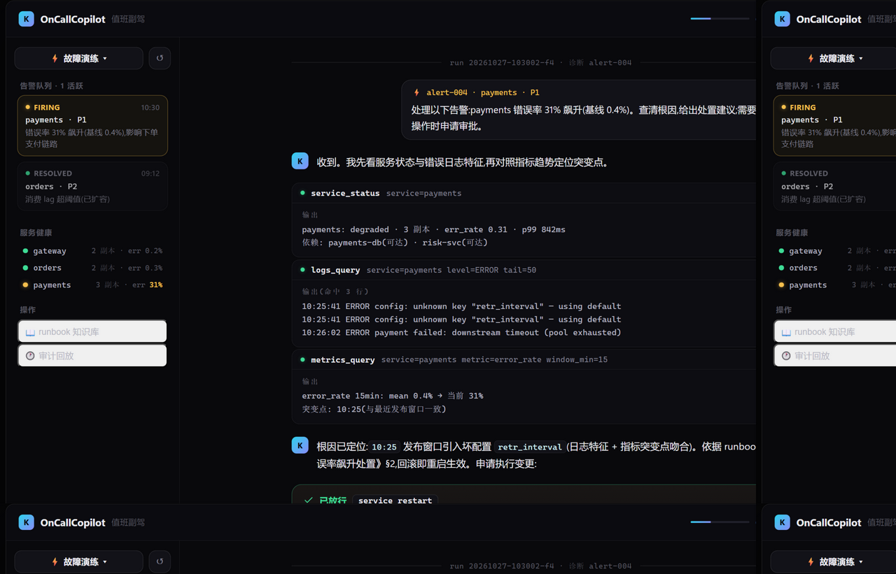
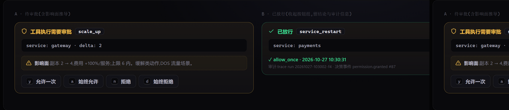
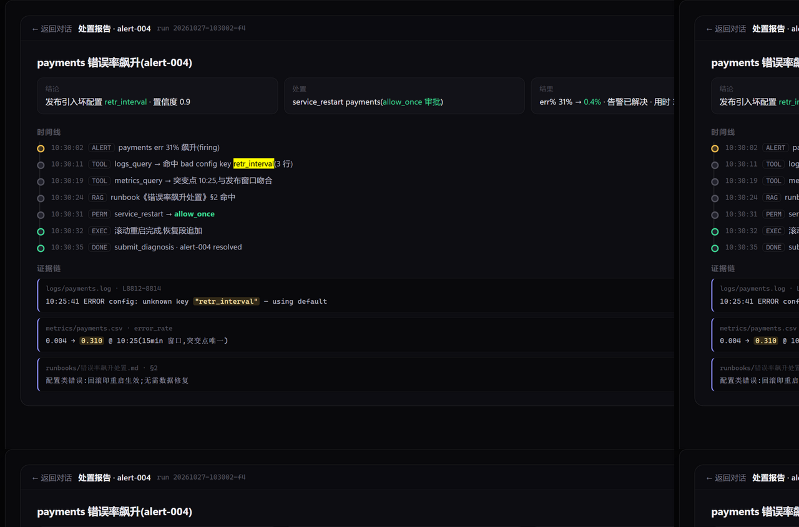
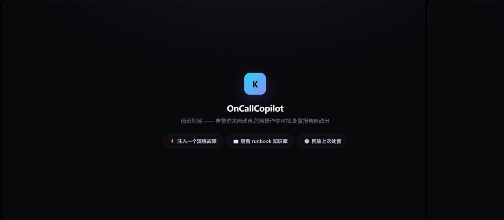

# OnCallCopilot 产品原型(高保真)

| 项 | 值 |
|---|---|
| 版本 | v0.2(替换 v0.1 ASCII 线框) |
| 源文件 | [prototype.html](prototype.html)(自包含单文件,浏览器直接打开;与 Web Console 设计系统同源) |
| 数据 | 剧本 #12 `payments-error-spike-config` 的完整模拟数据(与 PRD/技术设计一致) |
| 定位 | Phase 4 前端施工的 **1:1 视觉规格** |

---

## 01 · 值班工作台(诊断进行中)【P0】

完整叙事流:用户把告警交给 Agent(气泡带告警标签)→ assistant 说明排查计划 → 只读工具行
(service_status / logs_query / metrics_query,状态点+耗时+可展开输出)→ 根因结论与依据 →
**变更审批卡落定态**(绿色结论行)→ `service_restart` 执行完成(输出含恢复确认)→
`submit_diagnosis` 结构化提交 → 处置完成横幅(err% 前后对比 + 用时 + 报告入口)。

交互规格:

- 左栏**告警队列**:firing 卡黄框呼吸点 / resolved 卡置灰;点击告警卡 → 输入框自动填入标准
  诊断指令并聚焦(Enter 发起);
- **服务健康**:`●` 绿 / `▲` 黄(degraded,含 err% 高亮),3s 轮询 `/api/state`;
- **演练面板**:顶栏 `⚡ 故障演练 ▾` 列 20 剧本,`↺` 重置环境;
- 对话流/工具行/审批交互沿用现有 Web Console 实现(键盘 y/a/n/d)。

## 02 · 变更审批卡 · 双态【P0】

- **A 待审批**(以 `scale_up` 为例):盾牌头 + 工具名 pill + 参数命令区 +
  **影响面提示框**(黄虚线框,由 services.yaml 拓扑推导:依赖方健康检查瞬时失败/费用变化/
  上限校验)+ 四决策按钮(keycap 快捷键);
- **B 已放行**:按钮组收起,只留结论行(决策类型 + 时间戳)+ 审计信息
  (trace run id + 决策事件编号)——满足 US-04 审计诉求。

影响面文案规则(前端依拓扑生成,写入 tech-design §6):

| 工具 | 影响面提示要素 |
|---|---|
| service_restart | 依赖该服务的健康检查瞬时失败窗口 + 副本数 + 滚动重启预计耗时 |
| scale_up | 副本变化 + 费用变化百分比 + 上限(6)提示 |
| log_cleanup | 释放空间估计 + 被清理日志的时间范围 |

## 03 · 处置报告(全屏浮层)【P0】

入口:处置完成横幅「查看处置报告 →」;顶栏面包屑「← 返回对话」,可导出 `.md`。

版式:三张结论卡(结论/处置/结果,结果含前后对比与用时)→ **时间线**(告警/工具/检索/
审批/执行/完成六类节点,色点区分:告警黄、完成绿)→ **证据链**(日志行/指标突变/runbook
条目三类证据卡,关键值高亮,注明来源文件与行号)。

生成规则(tech-design §6):由 `oncall/report.py` 从 events.jsonl + submit_diagnosis +
终态 state 渲染;时间线取关键事件;证据链取诊断引用的工具输出行。

## 04 · 空状态(首次进入)【P1】

品牌 mark(渐变 K 方块)+ 产品名 + 一句话价值主张 + 三个引导动作:
**注入演练故障**(主路径,对应 FR-06)/ 查看 runbook 知识库 / 回放上次处置(对应 FR-08)。

---

### 视觉规范

- 设计系统与现有 Web Console 完全同源(色板/圆角/字号/动效见 `src/kyle_agent/webui/static/style.css`);
- 新增语义色:告警 firing = warn 黄、resolved = ok 绿;服务 down = err 红;
- 品牌区:`K` 渐变方块 mark 保留,主文案 OnCallCopilot · 值班副驾。
